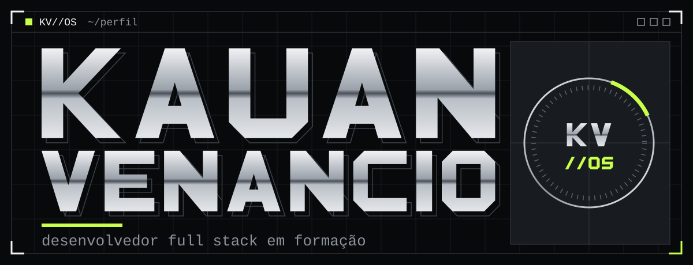
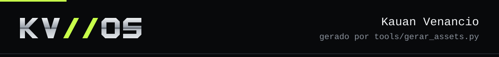

<h1 align="center"></h1>

## Sobre

Sou Kauan, desenvolvedor brasileiro em formação, com foco em desenvolvimento Full Stack. Sou técnico em Informática para Internet pela ETEC Prof. Maria Cristina Medeiros e estudante de Engenharia de Software na Uninter.

Me interessa o que as pessoas veem e tocam na web, a interface, e a engenharia que sustenta isso por baixo: dados, regras e versionamento. Este perfil é minha forma de organizar o que estudo e construo.


## Stack

```text
kauan@kv-os:~$ ls stack/

frontend/       JavaScript, React, HTML5, CSS3
backend/        Python, PHP
banco-dados/    MySQL, MariaDB
ambiente/       Git, GitHub
aprendendo/     Java
```

Java está em aprendizado. Não o listo como domínio.


## Projetos

<!-- Cada bloco abaixo é um campo de personalização: substitua os marcadores por dados reais ou remova o bloco. Veja README-CUSTOMIZATION.md. -->

> **[PREENCHER: nome do repositório 1]**
> [PREENCHER: descrição real do projeto, em uma frase]
> Tecnologias: [PREENCHER: tecnologias realmente usadas]
> Repositório: [PREENCHER: URL do repositório 1]

> **[PREENCHER: nome do repositório 2]**
> [PREENCHER: descrição real do projeto, em uma frase]
> Tecnologias: [PREENCHER: tecnologias realmente usadas]
> Repositório: [PREENCHER: URL do repositório 2]


## Contato

- GitHub: [PREENCHER: URL do seu perfil no GitHub]
- LinkedIn: [PREENCHER: URL do seu perfil no LinkedIn]
- E-mail: [PREENCHER: seu e-mail de contato]

<br>

<p align="center"></p>
