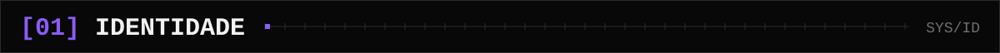
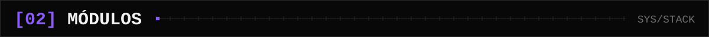
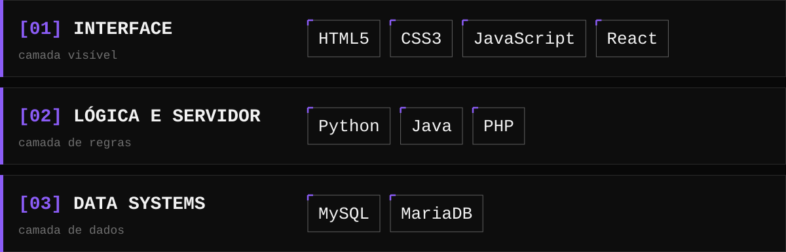
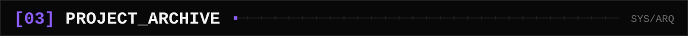
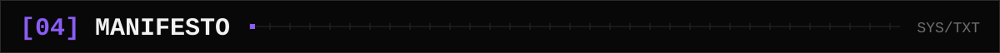

 <!--
KV//OS — README de perfil · Kauan Venancio

GUIA DE EDIÇÃO:
[EDITAR]  = substitua manualmente pelo seu dado real.
[OPCIONAL] = preencha somente se quiser exibir a informação.
[NÃO EDITAR] = elemento estrutural ou gerado automaticamente.

Os arquivos SVG ficam em /assets.
Não altere os caminhos dos assets sem mudar também as referências abaixo.
-->

<div align="center">


**DEVELOPER IN PROGRESS // BUILDING DIGITAL SYSTEMS**

[ `GITHUB` ](https://github.com/SEU_USUARIO) · [ `LINKEDIN` ](LINKEDIN_URL) · [ `PORTFOLIO` ](PORTFOLIO_URL)

</div>

---



```text
kauan@venancio:~$ whoami

Kauan Venancio

kauan@venancio:~$ cat formation.log

[CONCLUÍDO] Técnico em Informática para Internet
            ETEC Prof. Maria Cristina Medeiros (ETEC MCM)

[EM CURSO]  Engenharia de Software
            Uninter

kauan@venancio:~$ cat objective.txt

Desenvolvimento web · Front-end · Back-end
Interfaces modernas · Experiências digitais
Projetos próprios · Código · Experimentação

kauan@venancio:~$ status

Construindo. Aprendendo. Evoluindo.
```





```text
// Stack em evolução.
// Exiba somente tecnologias que você realmente conhece ou estuda.
```



```text
┌─ ARQ.001 ─────────────────────────────────────
│ ID       MYDASHBOARD
│ TIPO     Dashboard financeiro
│ RESUMO   Interface para visualização e
│          organização de informações financeiras.
│ STACK    React · JavaScript · Chart.js
│ REPO     [EDITAR: URL_DO_REPOSITORIO]
│ DEMO     [OPCIONAL: URL_DA_DEMO]
└───────────────────────────────────────────────

┌─ ARQ.002 ─────────────────────────────────────
│ ID       [EDITAR: NOME_DO_PROJETO]
│ TIPO     Aplicação web
│ RESUMO   [EDITAR: PROBLEMA QUE O PROJETO RESOLVE]
│ STACK    [EDITAR: TECNOLOGIAS REALMENTE UTILIZADAS]
│ REPO     [EDITAR: URL_DO_REPOSITORIO]
│ DEMO     [OPCIONAL: URL_DA_DEMO]
└───────────────────────────────────────────────

┌─ ARQ.003 ─────────────────────────────────────
│ ID       [EDITAR: NOME_DO_PROJETO]
│ TIPO     Sistema CRUD
│ RESUMO   [EDITAR: FUNCIONALIDADES PRINCIPAIS]
│ STACK    [EDITAR: LINGUAGENS + BANCO DE DADOS]
│ REPO     [EDITAR: URL_DO_REPOSITORIO]
│ DEMO     [OPCIONAL: URL_DA_DEMO]
└───────────────────────────────────────────────
```

<!--
[NÃO EDITAR] A estrutura visual dos blocos acima pode ser mantida.
[EDITAR] Substitua os campos indicados e remova projetos que ainda não
estejam prontos para apresentação pública.

Para adicionar links clicáveis, use o formato abaixo fora dos blocos:

[ `SOURCE CODE` ](URL_DO_REPOSITORIO) · [ `LIVE DEMO` ](URL_DA_DEMO)

Não publique URLs fictícias ou repositórios privados sem autorização.
-->



> **Sistemas começam como ideias mal resolvidas.**
>
> Eu construo, quebro e refaço até ficarem de pé — com a minha assinatura.


```text
LINKEDIN   [EDITAR: URL_DO_LINKEDIN]
E-MAIL     [OPCIONAL: EMAIL_PUBLICO]
PORTFÓLIO  [OPCIONAL: URL_DO_PORTFOLIO]
```

<div align="center">

```text
EOF · KV//OS v1.0 · SESSION ACTIVE
```

<sub>DESIGNED TO EVOLVE // BUILT BY KAUAN VENANCIO</sub>

</div>
